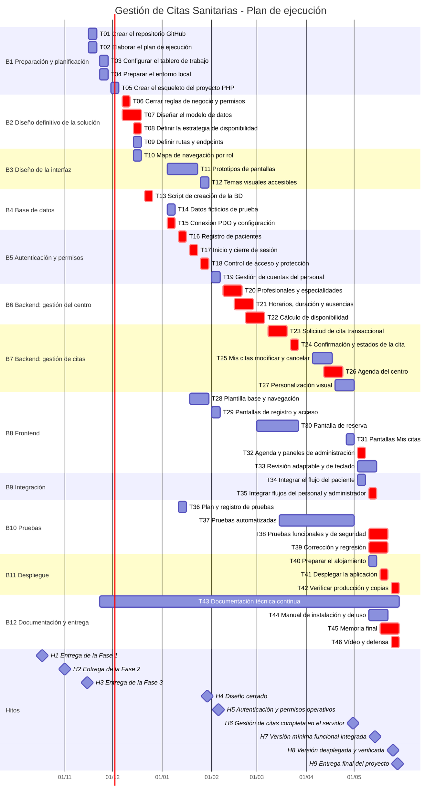

# Cronograma

Diagrama de Gantt de la planificación inicial. GitHub lo muestra directamente. Para actualizarlo, modifica las fechas y vuelve a hacer commit. Las tareas marcadas como `crit` forman el camino crítico.

Las fechas siguen el calendario de 2.º curso 2026-2027. La semana del 28/12/2026 (Navidad) y la del 29/03/2027 (Pascua) no tienen tareas asignadas: son la reserva de contingencia. Las semanas de preparación y exámenes de evaluación (23/11-04/12 y 01/02-12/02) y la Formación en Empresa (01/03-09/05/2027) tienen la carga reducida.

## Hitos

| Hito | Descripción                                                 | Fecha prevista |
| ---- | ----------------------------------------------------------- | -------------- |
| H1   | Entrega de la Fase 1 (Análisis de la necesidad y propuesta) | 18/10/2026     |
| H2   | Entrega de la Fase 2 (Diseño y viabilidad)                  | 01/11/2026     |
| H3   | Entrega de la Fase 3 (plan de ejecución)                    | 15/11/2026     |
| H4   | Diseño cerrado (modelo de datos, prototipos y temas)        | 29/01/2027     |
| H5   | Autenticación y permisos operativos                         | 05/02/2027     |
| H6   | Gestión de citas completa en el servidor                    | 30/04/2027     |
| H7   | Versión mínima funcional integrada                          | 14/05/2027     |
| H8   | Versión desplegada y verificada                             | 25/05/2027     |
| H9   | Entrega final del proyecto                                  | 28/05/2027     |

## Historial de cambios del cronograma

| Fecha      | Cambio                | Motivo |
| ---------- | --------------------- | ------ |
| 15/11/2026 | Planificación inicial | Fase 3 |
